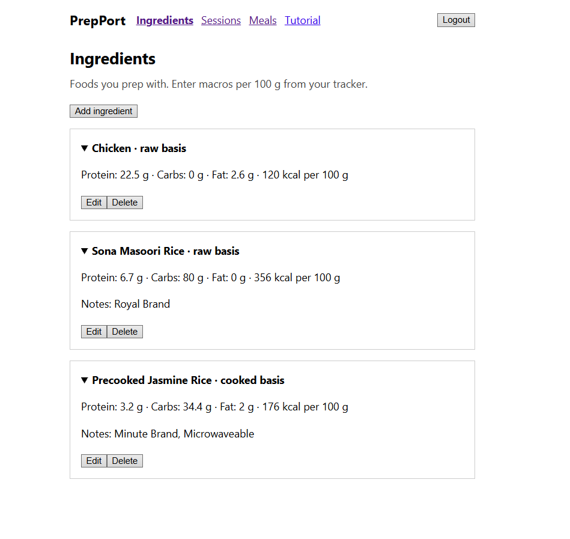
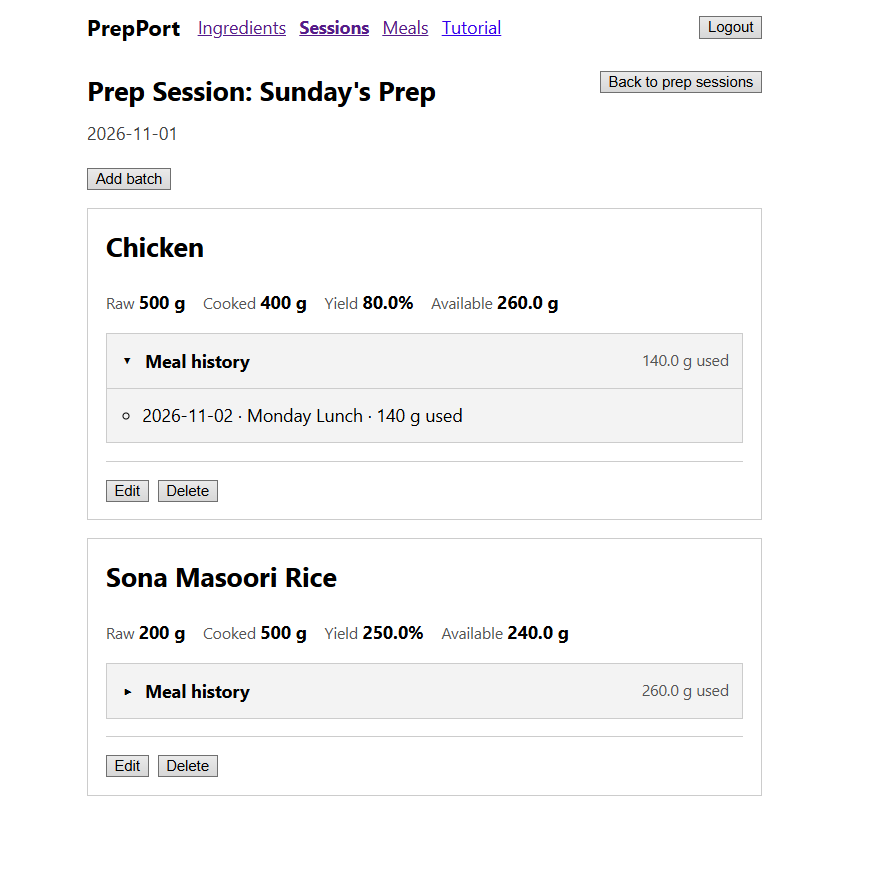
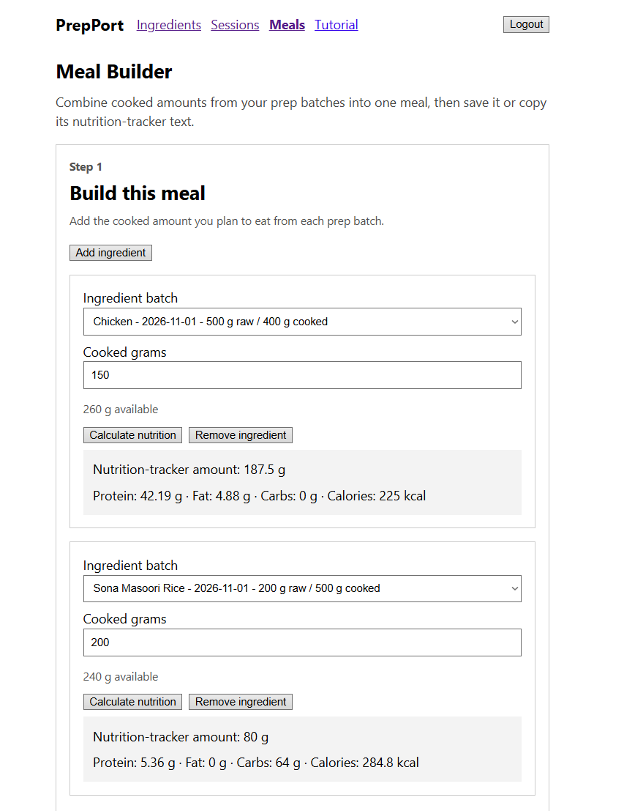
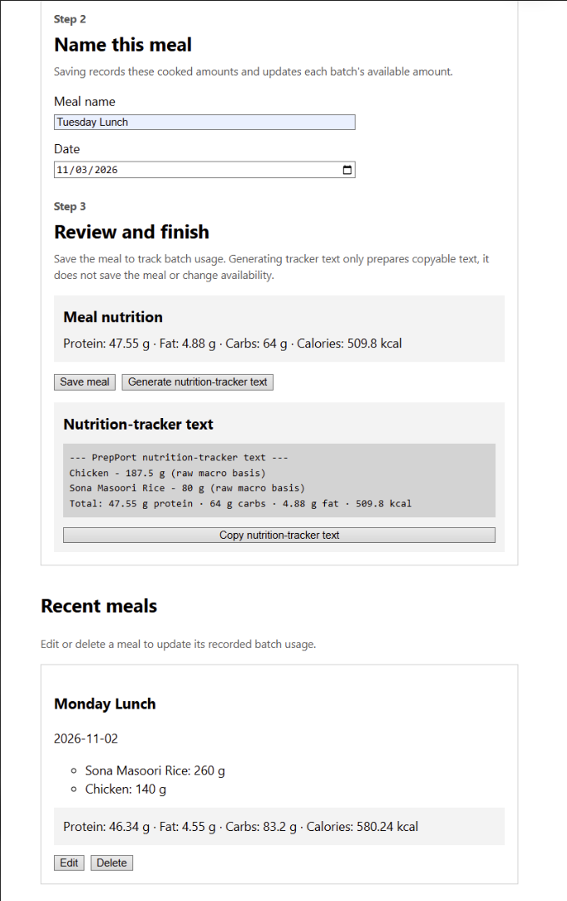
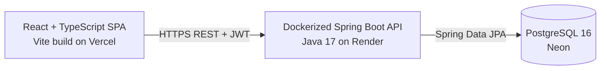
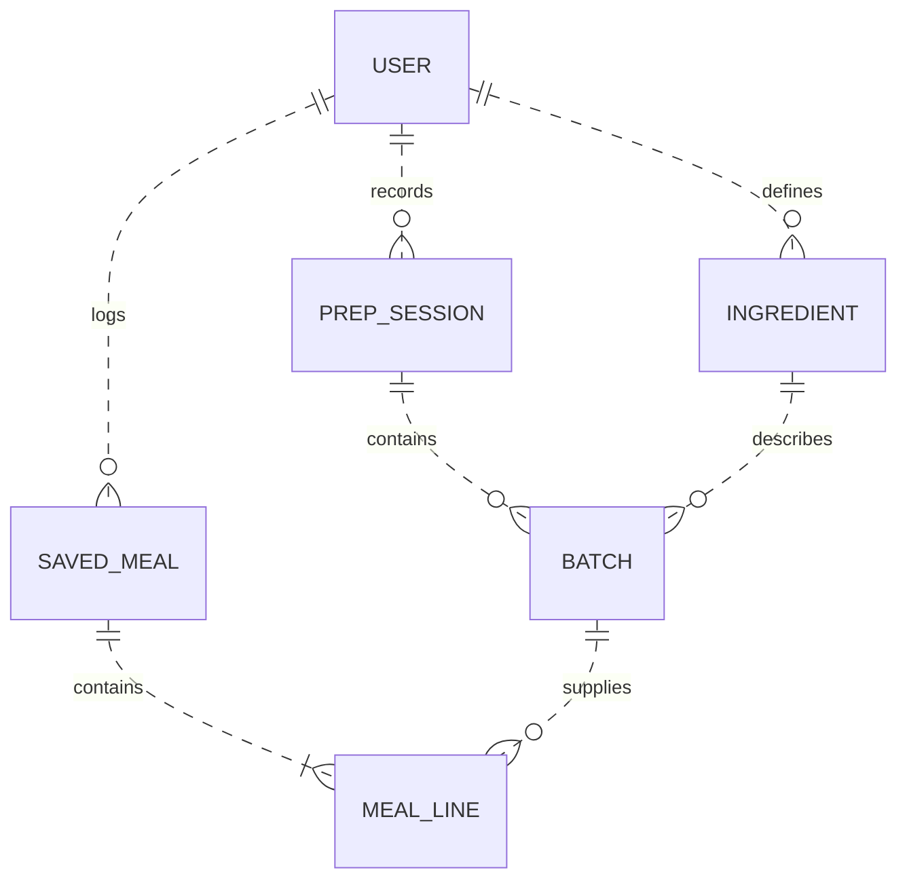

# PrepPort

A generic cooked-chicken entry in a nutrition tracker assumes a cooking yield that can differ from yours. Roasting and grilling can remove different amounts of moisture, so two portions with the same cooked weight can represent different raw weights.

PrepPort is a meal-prep app that uses your measured batch weights to calculate how much to log against the raw nutrition entry. If 1,000 g of raw chicken cooks down to 750 g, a 150 g cooked portion corresponds to **200 g raw**. If another 1,000 g batch cooks down to 600 g, a serving of the same cooked weight corresponds to **250 g raw**.

## App walkthrough

Select a screenshot to view it at full size.

<table>
  <tr>
    <td width="50%" valign="top">
       
      <strong>1. Define ingredients</strong> 
      Store nutrition per 100 g using raw or cooked food values, depending on the nutritional reference.
    </td>
    <td width="50%" valign="top">
       
      <strong>2. Track prep batches</strong> 
      Record raw and cooked weights to calculate cooking yield, remaining inventory, and meal usage history.
    </td>
  </tr>
  <tr>
    <td width="50%" valign="top">
       
      <strong>3. Build a meal</strong> 
      Combine cooked portions from prepared batches and calculate nutrition using each batch's measured yield.
    </td>
    <td width="50%" valign="top">
       
      <strong>4. Review and export</strong> 
      View meal nutrition, generate a copyable tracking summary, and access previously saved meals.
    </td>
  </tr>
</table>

**[Live demo](https://prepport.vercel.app)**

Note: The demo uses free hosting, so the first request may take up to a minute while the backend starts.

## How it works

1. Choose the nutrition basis that matches the reference. PrepPort uses the portion’s cooked weight directly for cooked-basis entries.
2. Record the raw and cooked weights for each batch. The chicken shown above went from 500 g raw to 400 g cooked, giving it an 80% yield.
3. Weigh your cooked portions. For raw-basis entries, PrepPort divides the portion’s cooked weight by the batch yield. In the walkthrough, 150 g of cooked chicken becomes 187.5 g for the raw nutrition entry.

## Architecture

Spring Boot controllers handle HTTP requests, services apply meal and nutrition rules, and Spring Data repositories access PostgreSQL. The same nutrition calculation powers meal previews, saved meals, and copyable summaries, keeping results consistent. Spring Security verifies JWTs, and repository queries scope protected records to the signed-in user.

## Data model

- A **batch** records the raw and cooked weights of one preparation of an ingredient.
- A **prep session** groups batches prepared together.
- A **meal line** records the cooked grams taken from one batch.
- A **saved meal** is a dated collection of meal lines that can draw from different prep sessions.

A Sunday prep session can group chicken and broccoli together. Wednesday’s lunch can use that chicken alongside rice cooked on Tuesday. Each meal line points back to its source batch, so PrepPort can use that batch’s measured yield when converting a portion to raw weight.

## Engineering details

- **Inventory derived from meal history.** Remaining cooked weight is the batch’s cooked weight minus the total recorded on its meal lines. Editing or deleting a meal changes that total without maintaining a separate inventory counter.
- **Validation before saving.** The API combines repeated portions from the same batch before checking available inventory. When editing a meal, its previous portions are credited back before validating the new amounts.
- **Dependency-aware deletion.** Before deleting a prep session, the app warns how many saved meals depend on it and requires confirmation. The API then deletes the session, its batches, and the affected saved meals in one transaction.
- **Backend tests.** Coverage includes yield and macro calculations, missing batches, batch weight changes, and deletion rules for referenced records.
